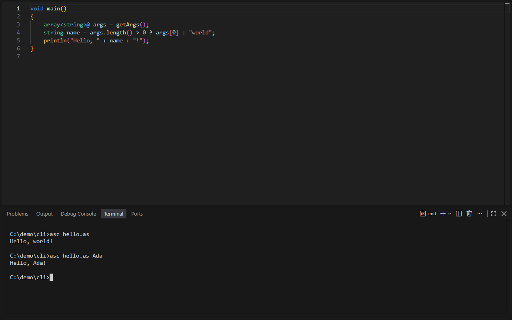
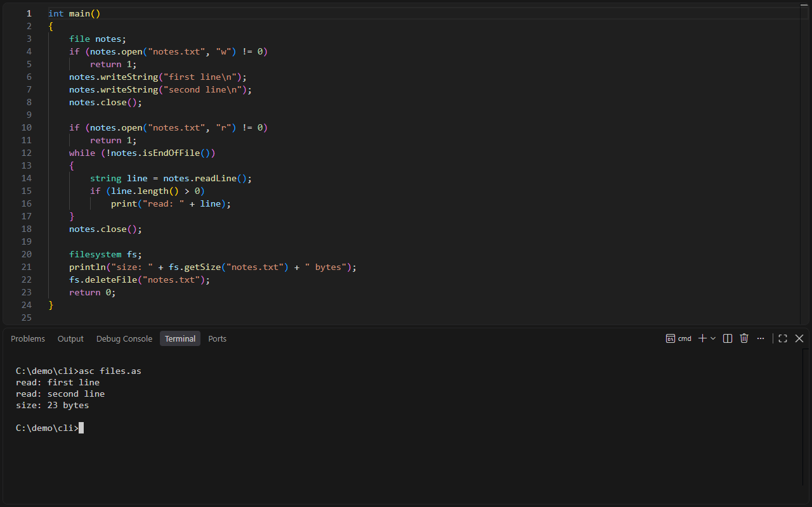
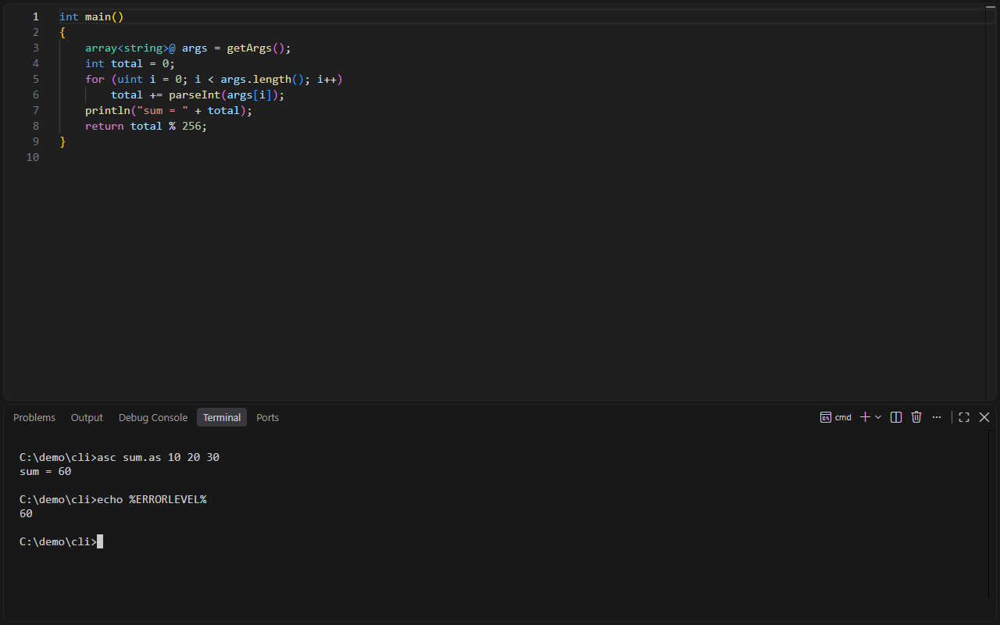
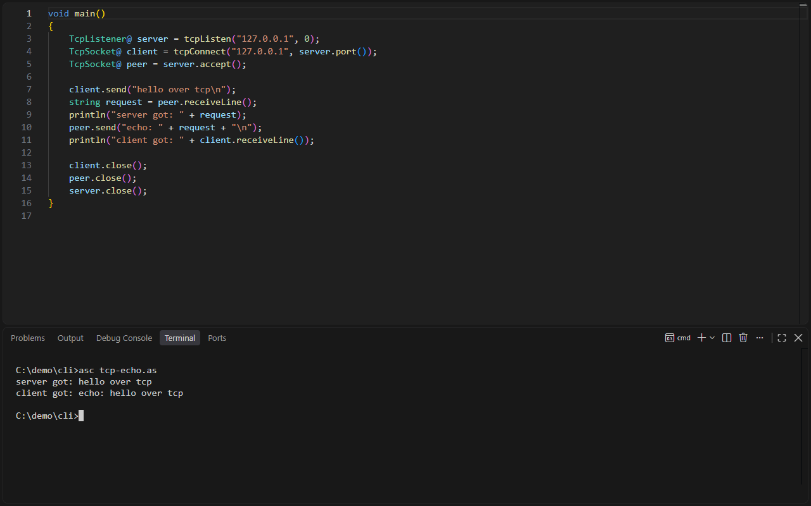
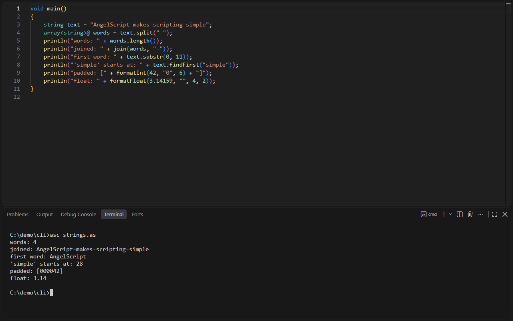
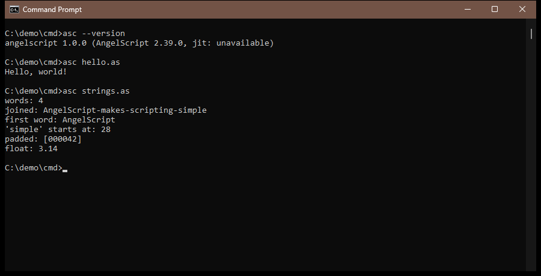

# AngelScript CLI

**[English](README.md)** | **[Español](docs/README.es.md)**

Run, check and debug standalone AngelScript scripts from the terminal, the way you run Python or Node. One small program with files, strings, dates and TCP sockets built in.

<p align="center"></p>

## Install

| System | Command |
| --- | --- |
| Windows | Download `angelscript-cli-1.2.0-windows-x64-setup.exe` from [Releases](https://github.com/angelscript-tools/angelscript-cli/releases/latest) and run it. |
| macOS | Download `angelscript-cli-1.2.0-macos-arm64.pkg` (Apple silicon) or `-macos-x64.pkg` (Intel) and open it. |
| Linux | `sudo apt install ./angelscript-cli-1.2.0-linux-x64.deb` |
| Any, no administrator | `irm https://raw.githubusercontent.com/angelscript-tools/angelscript-cli/main/scripts/install.ps1 \| iex` or `curl -fsSL https://raw.githubusercontent.com/angelscript-tools/angelscript-cli/main/scripts/install.sh \| sh` |

Open a new terminal and run `asc --version`. The setup steps, the other architectures and the installer options are in [docs/INSTALL.md](docs/INSTALL.md).

## Examples

Every script lives in [`examples/`](examples). `asc --check script.as` compiles without running.

<p align="center"></p>
<p align="center"><em>Files: write, read, list and delete.</em></p>

<p align="center"></p>
<p align="center"><em>Arguments and exit codes: <code>main()</code> returns the process code.</em></p>

<p align="center"></p>
<p align="center"><em>TCP sockets: a client and a server in one script.</em></p>

<p align="center"></p>
<p align="center"><em>Strings: split, join, search and format.</em></p>

<p align="center"></p>
<p align="center"><em>No editor needed: any terminal runs them.</em></p>

## Use with VS Code

1. Install the [AngelScript extension](https://marketplace.visualstudio.com/items?itemName=Gaftherman.angelscript-gaftherman) and open a `.as` file.
2. Add `{ "type": "angelscript", "request": "launch", "name": "Run script", "program": "${file}" }` to `configurations` in `.vscode/launch.json`.
3. Press F5. To debug, run `asc --dap-port 9002 script.as` and attach.

<p align="center"></p>

<p align="center"></p>

The editor stub, the debug configuration and the command list are in [docs/REFERENCE.md](docs/REFERENCE.md).

## Building from source

```sh
git clone https://github.com/angelscript-tools/angelscript-cli.git
cd angelscript-cli
git submodule update --init
cmake --preset windows-x64
cmake --build --preset windows-x64
ctest --preset windows-x64
```

Presets: **windows-x64**, **windows-x86**, **linux-x64**, **linux-x86**, **linux-arm64**, **macos**. The optional JIT, ahead-of-time libraries and other AngelScript releases are in [docs/BUILDING.md](docs/BUILDING.md).

## Documentation

- [Install](docs/INSTALL.md) — the Windows setup step by step, packages and scripts.
- [Reference](docs/REFERENCE.md) — commands, exit codes, VS Code, debugging and editor support.
- [Building](docs/BUILDING.md) — build from source, JIT, AOT and other AngelScript releases.
- [Engine versions](https://github.com/angelscript-tools/angelscript-engine/blob/main/docs/ENGINE_VERSIONS.md) — what each release supports.
- [Recording the captures](docs/DEMOS.md) — how the images are made.
- [CHANGELOG.md](CHANGELOG.md) — release history.

## Roadmap

- Package management for AngelScript releases.
- JIT builds on every target, including AOT on 32-bit and macOS.

The plan and how it compares with the other AngelScript JITs are in [docs/ROADMAP.md](docs/ROADMAP.md).

## Support

Open an [issue](https://github.com/angelscript-tools/angelscript-cli/issues) for the command line program, the installers and the engine versions. Include the output of `angelscript --version`, your operating system and a short script that reproduces the problem. Debugger problems go to [angelscript-dap](https://github.com/angelscript-tools/angelscript-dap/issues), and editor problems to [angelscript-lsp](https://github.com/angelscript-tools/angelscript-lsp/issues). To help, read [CONTRIBUTING.md](CONTRIBUTING.md).

## Related

| Project | Use |
| --- | --- |
| [angelscript-lsp](https://github.com/angelscript-tools/angelscript-lsp) | Editor support for VS Code |
| [angelscript-dap](https://github.com/angelscript-tools/angelscript-dap) | The debugger core behind `--dap-port` |
| [angelscript-debugger-example](https://github.com/angelscript-tools/angelscript-debugger-example) | A host that shows how to use the debugger |
| [angelscript-jit](https://github.com/angelscript-tools/angelscript-jit) | Optional JIT compiler |
| [angelscript-engine](https://github.com/angelscript-tools/angelscript-engine) | Support for older AngelScript releases |

### Similar projects

- [sashi0034/angel-lsp](https://github.com/sashi0034/angel-lsp): another AngelScript language server, with host stubs.
- [asumagic/angelsea](https://github.com/asumagic/angelsea): the JIT that [angelscript-jit](https://github.com/angelscript-tools/angelscript-jit) forks.

## Credits

AngelScript CLI runs on the work of these projects. Their licenses are reproduced in [THIRD_PARTY_NOTICES.md](docs/THIRD_PARTY_NOTICES.md) and ship with every package.

| Project | License | Use |
| --- | --- | --- |
| [AngelScript](https://github.com/anjo76/angelscript) by Andreas Jönsson | zlib | The language and its runtime |
| [angelscript-dap](https://github.com/angelscript-tools/angelscript-dap) | MIT | Debug Adapter Protocol core |
| [cppdap](https://github.com/google/cppdap) | Apache-2.0 | Debug Adapter Protocol library |
| [nlohmann/json](https://github.com/nlohmann/json) | MIT | JSON, through cppdap |

## License

This repository is licensed under the [MIT License](LICENSE).
