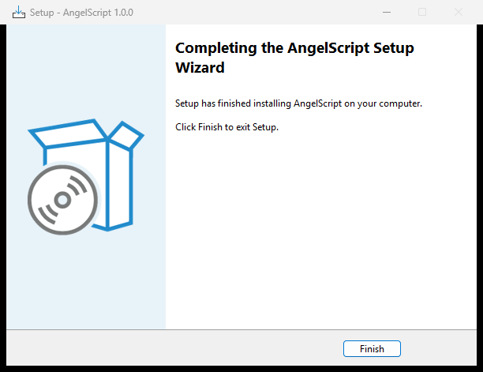

# AngelScript CLI

**[English](README.md)** | **[Español](README.es.md)**

Run, check and debug standalone AngelScript scripts from the terminal, the way you run Python or Node. One small program with files, strings, dates and TCP sockets built in.

~~~text
> asc hello.as
Hello, world!
~~~

## Install

### Windows

Download `angelscript-cli-1.0.0-windows-x64-setup.exe` from [Releases](https://github.com/Gaftherman/angelscript-cli/releases/latest) and run it.

1. Accept the license.

2. Choose the folder. The default is inside your user profile and needs no administrator rights.

3. Keep **Add AngelScript to the PATH environment variable** checked.

4. Press **Install**, then **Finish**.

Open a new terminal and run `asc --version`. To remove it, use **Settings > Apps**. The setup is not code-signed yet, so Windows SmartScreen may show **Windows protected your PC**: choose **More info**, then **Run anyway**.

### macOS

Download `angelscript-cli-1.0.0-macos-arm64.pkg` (Apple silicon) or `angelscript-cli-1.0.0-macos-x64.pkg` (Intel) from [Releases](https://github.com/Gaftherman/angelscript-cli/releases/latest) and open it. It installs into `/usr/local/bin`. The package is not notarized yet: if macOS blocks it, right-click it and choose **Open**.

### Linux

~~~sh
$ sudo apt install ./angelscript-cli-1.0.0-linux-x64.deb
~~~

Use `linux-arm64` on ARM. Remove it with `sudo apt remove angelscript-cli`.

### Scripts, without administrator rights

~~~powershell
> irm https://raw.githubusercontent.com/Gaftherman/angelscript-cli/main/scripts/install.ps1 | iex
~~~

~~~sh
$ curl -fsSL https://raw.githubusercontent.com/Gaftherman/angelscript-cli/main/scripts/install.sh | sh
~~~

Open a new terminal. Three names run the same program: `angelscript`, the short `asc` and the older `angelscript-cli`. To pick a version, set `ANGELSCRIPT_CLI_VERSION` in PowerShell or run `sh -s -- --version 1.0.0`. To install by hand, extract the archive from [Releases](https://github.com/Gaftherman/angelscript-cli/releases/latest).

## Quick start

Create `hello.as`:

~~~angelscript
void main()
{
    array<string>@ args = getArgs();
    string name = args.length() > 0 ? args[0] : "world";
    println("Hello, " + name + "!");
}
~~~

~~~text
> asc hello.as
Hello, world!
> asc hello.as Ada
Hello, Ada!
> asc --check hello.as
~~~

`--check` compiles without running and exits with 0 when the script is clean.

## Examples

Every example lives in [`examples/`](examples).

### Files

~~~angelscript
int main()
{
    file notes;
    if (notes.open("notes.txt", "w") != 0)
        return 1;
    notes.writeString("first line\n");
    notes.writeString("second line\n");
    notes.close();

    if (notes.open("notes.txt", "r") != 0)
        return 1;
    while (!notes.isEndOfFile())
    {
        string line = notes.readLine();
        if (line.length() > 0)
            print("read: " + line);
    }
    notes.close();

    filesystem fs;
    println("size: " + fs.getSize("notes.txt") + " bytes");
    fs.deleteFile("notes.txt");
    return 0;
}
~~~

~~~text
> asc files.as
read: first line
read: second line
size: 23 bytes
~~~

### Exit codes

~~~angelscript
int main()
{
    array<string>@ args = getArgs();
    int total = 0;
    for (uint i = 0; i < args.length(); i++)
        total += parseInt(args[i]);
    println("sum = " + total);
    return total % 256;
}
~~~

~~~text
> asc sum.as 10 20 30
sum = 60
> echo %ERRORLEVEL%
60
~~~

### TCP sockets

~~~angelscript
void main()
{
    TcpListener@ server = tcpListen("127.0.0.1", 0);
    TcpSocket@ client = tcpConnect("127.0.0.1", server.port());
    TcpSocket@ peer = server.accept();

    client.send("hello over tcp\n");
    string request = peer.receiveLine();
    println("server got: " + request);
    peer.send("echo: " + request + "\n");
    println("client got: " + client.receiveLine());

    client.close();
    peer.close();
    server.close();
}
~~~

~~~text
> asc tcp-echo.as
server got: hello over tcp
client got: echo: hello over tcp
~~~

Port `0` picks a free port. `accept()` waits for the next client, and the connection already waiting in the queue is enough for a single script to test both sides.

### More

| Script | Shows |
| --- | --- |
| [`listdir.as`](examples/listdir.as) | Create a folder, list its files sorted, remove it |
| [`strings.as`](examples/strings.as) | Split, join, substrings, search and number formatting |
| [`dates.as`](examples/dates.as) | Build a date, add time, compare and subtract |

~~~text
> asc strings.as
words: 4
joined: AngelScript-makes-scripting-simple
first word: AngelScript
'simple' starts at: 28
padded: [000042]
float: 3.14
~~~

## Use with VS Code

1. Install the [AngelScript extension](https://marketplace.visualstudio.com/items?itemName=Gaftherman.angelscript-gaftherman) and open a `.as` file.
2. Add this to `configurations` in `.vscode/launch.json`:

~~~json
{ "type": "angelscript", "request": "launch", "name": "Run script", "program": "${file}" }
~~~

3. Press F5. The extension finds `angelscript`, `asc` or `angelscript-cli` on PATH. Set `angelscript.runner.path` to use another executable.

<em>The extension checks the code as you type. The terminal runs it with <code>asc</code>.</em>

<em>A TCP echo example and its output.</em>

### Editor support

[`examples/angelscript-cli.as.predefined`](examples/angelscript-cli.as.predefined) describes every type and function the CLI registers (`string`, `array`, `dictionary`, `file`, `datetime`, `filesystem`, `TcpSocket`, `println`, `getArgs` and more), so [AngelLSP](https://github.com/Gaftherman/angelscript-lsp) checks your scripts without reporting those names as unknown. [`examples/angelscript.rules.json`](examples/angelscript.rules.json) declares the engine version. Regenerate the stub for another build with `angelscript --dump-predefined > my.as.predefined`.

## Reference

| Command | Does |
| --- | --- |
| `asc script.as [args]` | Run `main()`. Arguments reach the script through `getArgs()` |
| `asc --check script.as` | Compile only |
| `asc --dap-port 9002 script.as` | Wait for a debugger on port 9002, then run |
| `asc --version`, `asc --help` | Print the version or the usage |

Exit codes: **0** success or `void main()`, **1** compile or runtime error, **2** invalid command line. A script with `int main()` supplies its own code.

Built in: strings and string utilities, arrays, dictionaries, math, files, filesystem, date and time, exception helpers, `print`, `println`, `getArgs` and TCP sockets (`tcpConnect`, `tcpListen`).

## Build from source

Use a C++20 compiler, CMake 3.21+ and Ninja. Use an x64 developer terminal for MSVC. Node.js enables the DAP test. Choose **windows-x64**, **linux-x64**, **linux-arm64** or **macos**.

~~~sh
git clone --recursive https://github.com/Gaftherman/angelscript-cli.git
cd angelscript-cli
cmake --preset windows-x64
cmake --build --preset windows-x64
ctest --preset windows-x64
~~~

## Roadmap

[Package management and JIT](docs/ROADMAP.md)

## Credits

AngelScript CLI runs on the work of these projects. Their licenses are reproduced in [THIRD_PARTY_NOTICES.md](THIRD_PARTY_NOTICES.md) and ship with every package.

| Project | License | Use |
| --- | --- | --- |
| [AngelScript](https://github.com/anjo76/angelscript) by Andreas Jönsson | zlib | The language and its runtime |
| [asdebugger](https://github.com/Gaftherman/asdebugger) | MIT | Debug Adapter Protocol core |
| [cppdap](https://github.com/google/cppdap) | Apache-2.0 | Debug Adapter Protocol library |
| [nlohmann/json](https://github.com/nlohmann/json) | MIT | JSON, through cppdap |

## License

[MIT](LICENSE)
