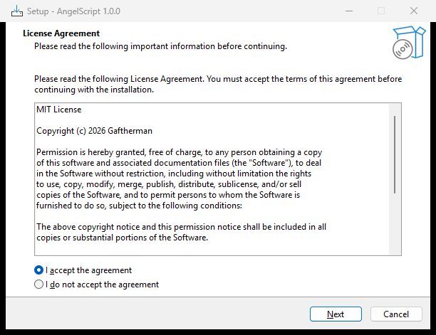
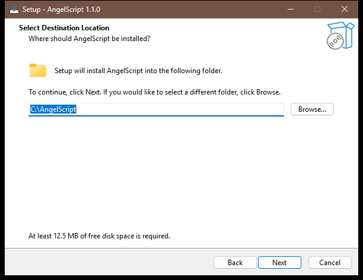
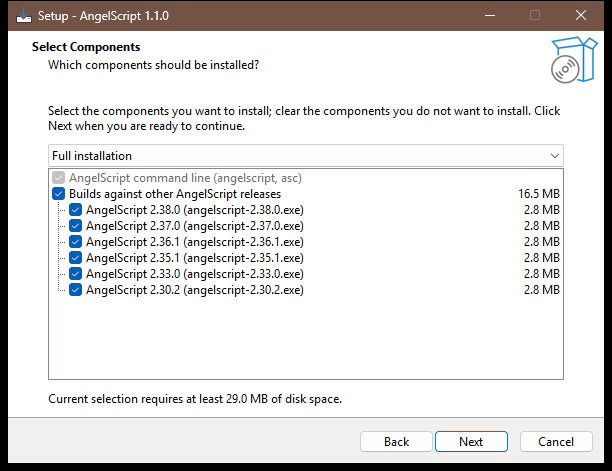
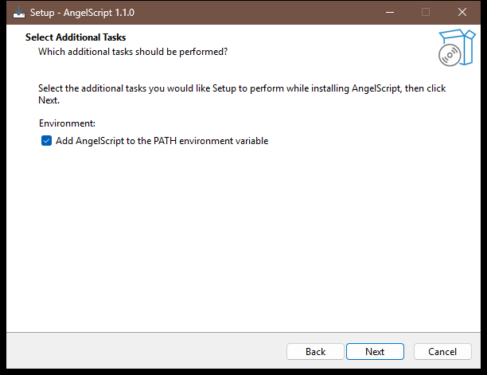
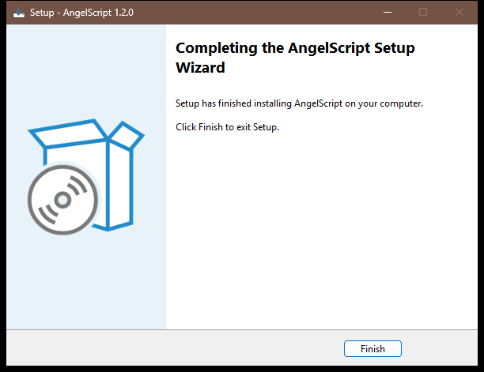

# Instalación

**[English](INSTALL.md)** | **[Español](INSTALL.es.md)**

## Windows

Descarga `angelscript-cli-1.2.0-windows-x64-setup.exe` desde [Releases](https://github.com/angelscript-tools/angelscript-cli/releases/latest) y ejecútalo. En Windows de 32 bits usa `angelscript-cli-1.2.0-windows-x86-setup.exe`.

1. Acepta la licencia.

<p align="center"></p>

2. Elige la carpeta. La predeterminada está en tu perfil de usuario y no necesita permisos de administrador.

<p align="center"></p>

3. Elige la versión de AngelScript. Como Python, el instalador pone una versión a la vez, como `angelscript`, `asc` y `angelscript-cli`; viene marcada la más reciente. Cada línea indica si esa versión tiene compilación con JIT y qué add-ons le faltan (las más antiguas no tienen `datetime` ni `filesystem`). Bajo una versión con JIT, marca **Usar el compilador JIT** para instalar la variante con JIT (experimental, 64 bits). Ejecuta el instalador otra vez cuando quieras para cambiar la versión instalada. Las versiones distintas de la más reciente aparecen cuando sus compilaciones se adjuntan a la release, unos minutos después de publicarla.

<p align="center"></p>

4. Deja marcada **Add AngelScript to the PATH environment variable** (añadir AngelScript a la variable PATH).

<p align="center"></p>

5. Pulsa **Install** y después **Finish**.

<p align="center"></p>

Abre una terminal nueva y ejecuta `asc --version`. Para quitarlo, usa **Configuración > Aplicaciones**. El instalador aún no está firmado, así que Windows SmartScreen puede mostrar **Windows protegió su PC**: elige **Más información** y después **Ejecutar de todas formas**.

## macOS

Descarga `angelscript-cli-1.2.0-macos-arm64.pkg` (Apple silicon) o `angelscript-cli-1.2.0-macos-x64.pkg` (Intel) desde [Releases](https://github.com/angelscript-tools/angelscript-cli/releases/latest) y ábrelo. Se instala en `/usr/local/bin`. El paquete aún no está notarizado: si macOS lo bloquea, haz clic derecho y elige **Abrir**.

## Linux

```sh
sudo apt install ./angelscript-cli-1.2.0-linux-x64.deb
```

Usa `linux-arm64` en ARM y `linux-x86` en x86 de 32 bits. Para quitarlo, ejecuta `sudo apt remove angelscript-cli`.

## Scripts, sin permisos de administrador

```powershell
irm https://raw.githubusercontent.com/angelscript-tools/angelscript-cli/main/scripts/install.ps1 | iex
```

```sh
curl -fsSL https://raw.githubusercontent.com/angelscript-tools/angelscript-cli/main/scripts/install.sh | sh
```

Abre una terminal nueva. Tres nombres ejecutan el mismo programa: `angelscript`, el corto `asc` y el anterior `angelscript-cli`.

| Para elegir | PowerShell | sh |
| --- | --- | --- |
| La versión del CLI | `ANGELSCRIPT_CLI_VERSION` | `sh -s -- --version 1.2.0` |
| La versión de AngelScript | `ANGELSCRIPT_ENGINE_VERSION` | `sh -s -- --engine 2.36.1` |
| La compilación con JIT | `ANGELSCRIPT_CLI_JIT=1` | `--jit` |
| La arquitectura (`x64`, `x86`, `arm64`) | `ANGELSCRIPT_CLI_ARCH` | `--arch` |

La compilación elegida reemplaza a la instalada. Para instalar a mano, extrae el archivo de [Releases](https://github.com/angelscript-tools/angelscript-cli/releases/latest).
