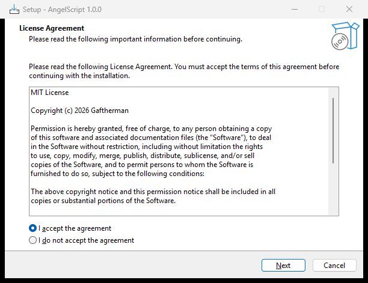
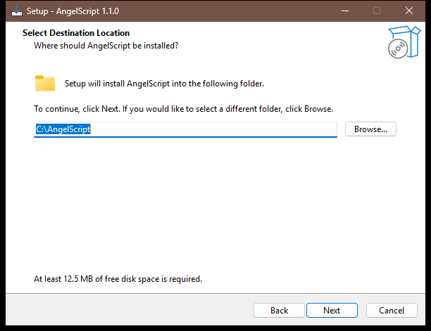
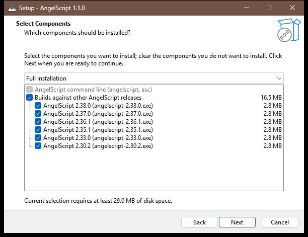
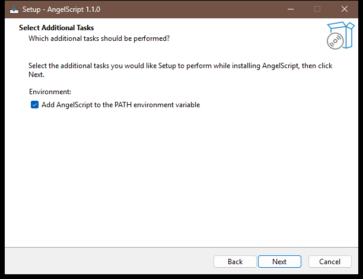
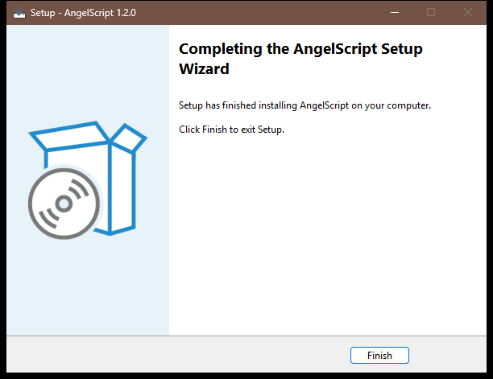

# Install

**[English](INSTALL.md)** | **[Español](INSTALL.es.md)**

## Windows

Download `angelscript-cli-1.2.0-windows-x64-setup.exe` from [Releases](https://github.com/Gaftherman/angelscript-cli/releases/latest) and run it. Use `angelscript-cli-1.2.0-windows-x86-setup.exe` on 32-bit Windows.

1. Accept the license.

<p align="center"></p>

2. Choose the folder. The default is inside your user profile and needs no administrator rights.

<p align="center"></p>

3. Choose the AngelScript release. Like Python, the setup installs one release at a time, as `angelscript`, `asc` and `angelscript-cli`; the newest one is selected. Each line says whether that release has a JIT build and which add-ons it lacks (the oldest releases have no `datetime` or `filesystem`). Under a release with a JIT build, tick **Use the JIT compiler** to install the JIT variant (experimental, 64-bit). Run the setup again at any time to replace the installed release with another one. The releases other than the newest appear once their builds are attached to the release, a few minutes after it is published.

<p align="center"></p>

4. Keep **Add AngelScript to the PATH environment variable** checked.

<p align="center"></p>

5. Press **Install**, then **Finish**.

<p align="center"></p>

Open a new terminal and run `asc --version`. To remove it, use **Settings > Apps**. The setup is not code-signed yet, so Windows SmartScreen may show **Windows protected your PC**: choose **More info**, then **Run anyway**.

## macOS

Download `angelscript-cli-1.2.0-macos-arm64.pkg` (Apple silicon) or `angelscript-cli-1.2.0-macos-x64.pkg` (Intel) from [Releases](https://github.com/Gaftherman/angelscript-cli/releases/latest) and open it. It installs into `/usr/local/bin`. The package is not notarized yet: if macOS blocks it, right-click it and choose **Open**.

## Linux

```sh
sudo apt install ./angelscript-cli-1.2.0-linux-x64.deb
```

Use `linux-arm64` on ARM and `linux-x86` on 32-bit x86. Remove it with `sudo apt remove angelscript-cli`.

## Scripts, without administrator rights

```powershell
irm https://raw.githubusercontent.com/Gaftherman/angelscript-cli/main/scripts/install.ps1 | iex
```

```sh
curl -fsSL https://raw.githubusercontent.com/Gaftherman/angelscript-cli/main/scripts/install.sh | sh
```

Open a new terminal. Three names run the same program: `angelscript`, the short `asc` and the older `angelscript-cli`.

| To choose | PowerShell | sh |
| --- | --- | --- |
| The CLI version | `ANGELSCRIPT_CLI_VERSION` | `sh -s -- --version 1.2.0` |
| The AngelScript release | `ANGELSCRIPT_ENGINE_VERSION` | `sh -s -- --engine 2.36.1` |
| The JIT build | `ANGELSCRIPT_CLI_JIT=1` | `--jit` |
| The architecture (`x64`, `x86`, `arm64`) | `ANGELSCRIPT_CLI_ARCH` | `--arch` |

The chosen build replaces the installed one. To install by hand, extract the archive from [Releases](https://github.com/Gaftherman/angelscript-cli/releases/latest).
