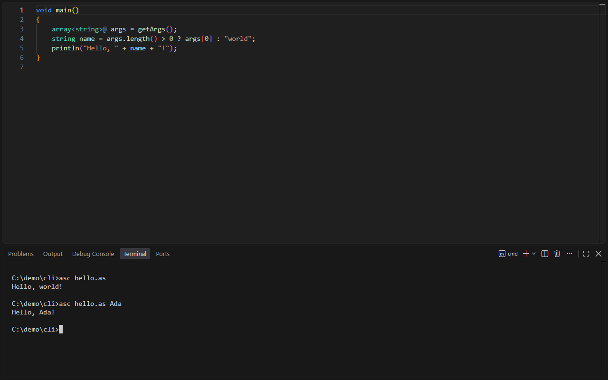
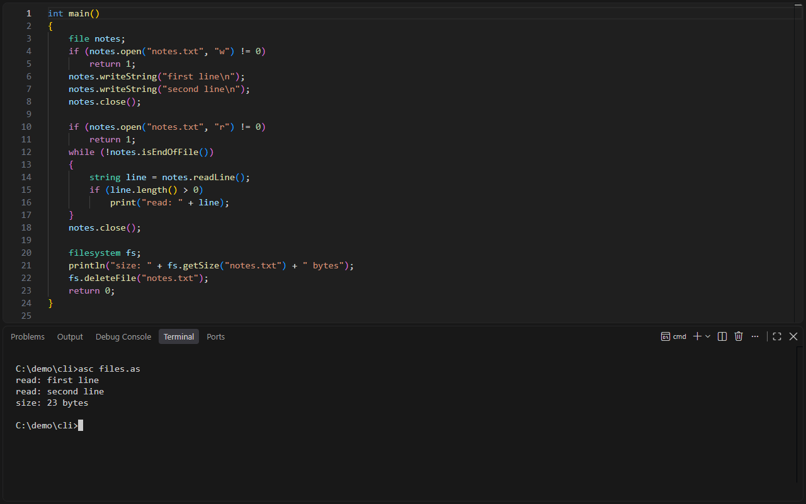
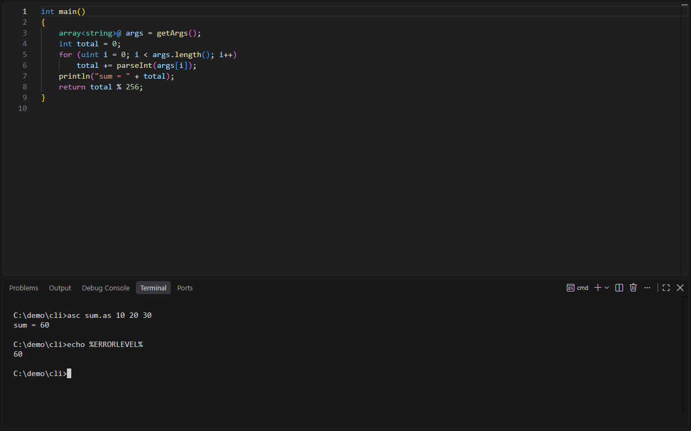
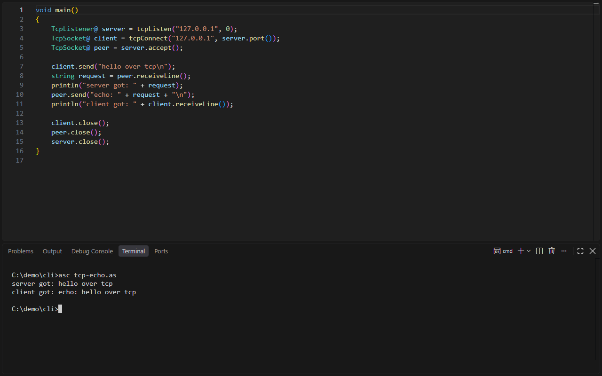
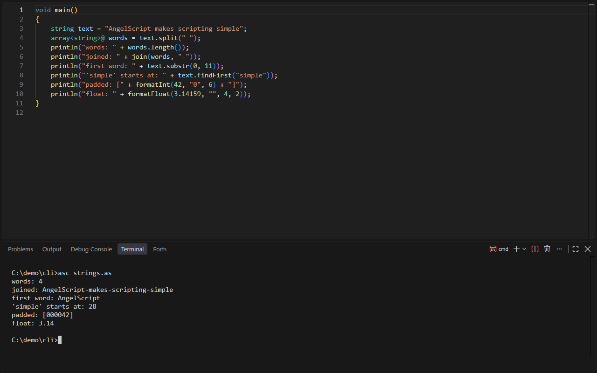
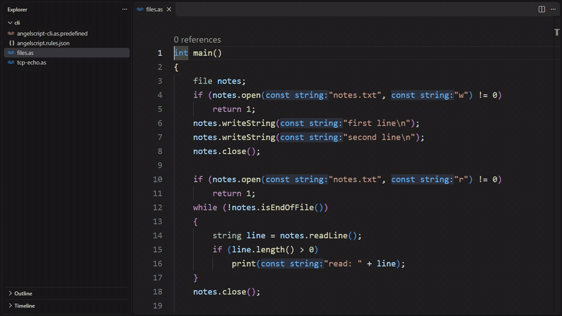

# AngelScript CLI

**[English](../README.md)** | **[Español](README.es.md)**

Ejecuta, comprueba y depura scripts de AngelScript desde la terminal, como ejecutas Python o Node. Un programa pequeño con archivos, cadenas, fechas y sockets TCP incluidos.

<p align="center"></p>

## Instalación

| Sistema | Comando |
| --- | --- |
| Windows | Descarga `angelscript-cli-1.2.0-windows-x64-setup.exe` desde [Releases](https://github.com/Gaftherman/angelscript-cli/releases/latest) y ejecútalo. |
| macOS | Descarga `angelscript-cli-1.2.0-macos-arm64.pkg` (Apple silicon) o `-macos-x64.pkg` (Intel) y ábrelo. |
| Linux | `sudo apt install ./angelscript-cli-1.2.0-linux-x64.deb` |
| Cualquiera, sin administrador | `irm https://raw.githubusercontent.com/Gaftherman/angelscript-cli/main/scripts/install.ps1 \| iex` o `curl -fsSL https://raw.githubusercontent.com/Gaftherman/angelscript-cli/main/scripts/install.sh \| sh` |

Abre una terminal nueva y ejecuta `asc --version`. Los pasos del instalador, las otras arquitecturas y sus opciones están en [INSTALL.es.md](INSTALL.es.md).

## Ejemplos

Cada script está en [`examples/`](../examples). `asc --check script.as` compila sin ejecutar.

<p align="center"></p>
<p align="center"><em>Archivos: escribir, leer, listar y borrar.</em></p>

<p align="center"></p>
<p align="center"><em>Argumentos y códigos de salida: <code>main()</code> devuelve el código del proceso.</em></p>

<p align="center"></p>
<p align="center"><em>Sockets TCP: un cliente y un servidor en un solo script.</em></p>

<p align="center"></p>
<p align="center"><em>Cadenas: dividir, unir, buscar y dar formato.</em></p>

<p align="center"></p>
<p align="center"><em>No hace falta un editor: cualquier terminal los ejecuta.</em></p>

## Usar con VS Code

1. Instala la [extensión de AngelScript](https://marketplace.visualstudio.com/items?itemName=Gaftherman.angelscript-gaftherman) y abre un archivo `.as`.
2. Añade `{ "type": "angelscript", "request": "launch", "name": "Run script", "program": "${file}" }` a `configurations` en `.vscode/launch.json`.
3. Pulsa F5. Para depurar, ejecuta `asc --dap-port 9002 script.as` y conecta.

<p align="center"></p>

<p align="center"></p>

El stub del editor, la configuración de depuración y la lista de comandos están en [REFERENCE.es.md](REFERENCE.es.md).

## Compilar desde el código fuente

```sh
git clone https://github.com/Gaftherman/angelscript-cli.git
cd angelscript-cli
git submodule update --init
cmake --preset windows-x64
cmake --build --preset windows-x64
ctest --preset windows-x64
```

Preajustes: **windows-x64**, **windows-x86**, **linux-x64**, **linux-x86**, **linux-arm64**, **macos**. El JIT opcional, las bibliotecas por adelantado y otras versiones de AngelScript están en [BUILDING.es.md](BUILDING.es.md).

## Documentación

- [Instalación](INSTALL.es.md) — el instalador de Windows paso a paso, paquetes y scripts.
- [Referencia](REFERENCE.es.md) — comandos, códigos de salida, VS Code, depuración y soporte del editor.
- [Compilar](BUILDING.es.md) — compilar desde el código, JIT, AOT y otras versiones de AngelScript.
- [Versiones del motor](https://github.com/Gaftherman/angelscript-engine/blob/main/docs/ENGINE_VERSIONS.md) — qué admite cada versión.
- [Grabar las capturas](DEMOS.md) (en inglés) — cómo se generan las imágenes.
- [CHANGELOG.md](../CHANGELOG.md) — historial de versiones.

## Hoja de ruta

- Gestión de paquetes para las versiones de AngelScript.
- Compilaciones con JIT en todos los destinos, incluido AOT en 32 bits y macOS.

El plan y su comparación con los otros JIT de AngelScript están en [ROADMAP.md](ROADMAP.md) (en inglés).

## Soporte

Abre una [incidencia](https://github.com/Gaftherman/angelscript-cli/issues) para el programa de línea de comandos, los instaladores y las versiones del motor. Incluye la salida de `angelscript --version`, tu sistema operativo y un script corto que reproduzca el problema. Los problemas del depurador van a [angelscript-dap](https://github.com/Gaftherman/angelscript-dap/issues) y los del editor a [angelscript-lsp](https://github.com/Gaftherman/angelscript-lsp/issues). Para ayudar, lee [CONTRIBUTING.es.md](CONTRIBUTING.es.md).

## Relacionados

| Proyecto | Uso |
| --- | --- |
| [angelscript-lsp](https://github.com/Gaftherman/angelscript-lsp) | Soporte del editor para VS Code |
| [angelscript-dap](https://github.com/Gaftherman/angelscript-dap) | El núcleo del depurador detrás de `--dap-port` |
| [angelscript-debugger-example](https://github.com/Gaftherman/angelscript-debugger-example) | Una aplicación que muestra cómo usar el depurador |
| [angelscript-jit](https://github.com/Gaftherman/angelscript-jit) | Compilador JIT opcional |
| [angelscript-engine](https://github.com/Gaftherman/angelscript-engine) | Soporte de versiones antiguas de AngelScript |

### Proyectos similares

- [sashi0034/angel-lsp](https://github.com/sashi0034/angel-lsp): otro servidor de lenguaje de AngelScript, con stubs de aplicaciones.
- [asumagic/angelsea](https://github.com/asumagic/angelsea): el JIT del que [angelscript-jit](https://github.com/Gaftherman/angelscript-jit) es fork.

## Créditos

AngelScript CLI se apoya en el trabajo de estos proyectos. Sus licencias se reproducen en [THIRD_PARTY_NOTICES.md](THIRD_PARTY_NOTICES.md) y se incluyen en cada paquete.

| Proyecto | Licencia | Uso |
| --- | --- | --- |
| [AngelScript](https://github.com/anjo76/angelscript) de Andreas Jönsson | zlib | El lenguaje y su runtime |
| [angelscript-dap](https://github.com/Gaftherman/angelscript-dap) | MIT | Núcleo del Debug Adapter Protocol |
| [cppdap](https://github.com/google/cppdap) | Apache-2.0 | Biblioteca del Debug Adapter Protocol |
| [nlohmann/json](https://github.com/nlohmann/json) | MIT | JSON, a través de cppdap |

## Licencia

Este repositorio está bajo la [licencia MIT](../LICENSE).
