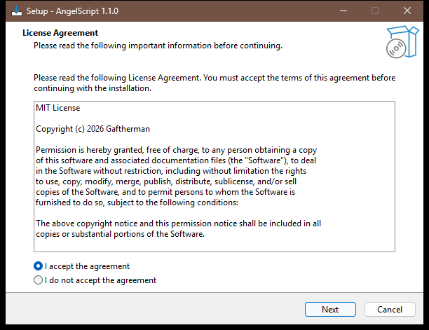
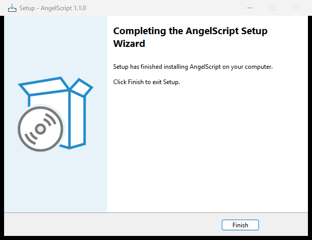
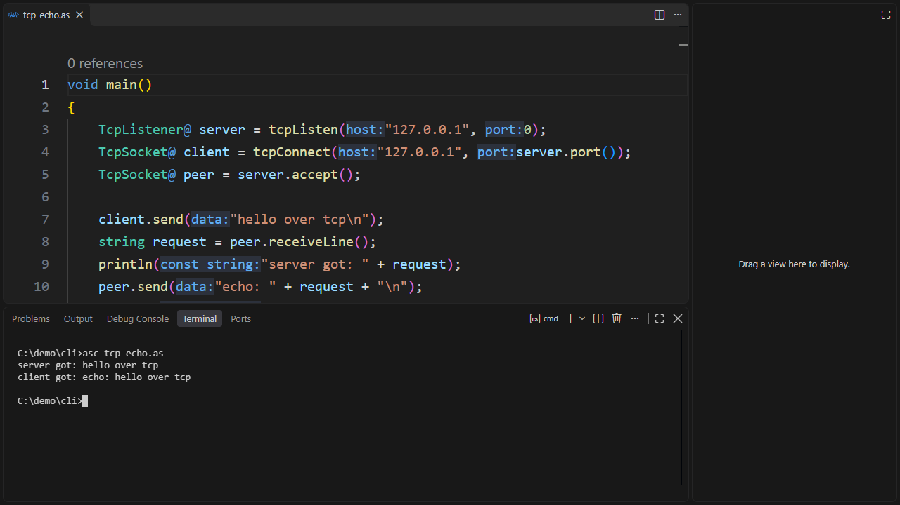
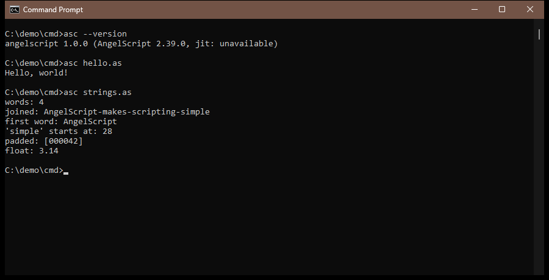

# AngelScript CLI

**[English](../README.md)** | **[Español](README.es.md)**

Ejecuta, comprueba y depura scripts de AngelScript desde la terminal, como ejecutas Python o Node. Un programa pequeño con archivos, cadenas, fechas y sockets TCP incluidos.

~~~text
> asc hello.as
Hello, world!
~~~

## Instalación

### Windows

Descarga `angelscript-cli-1.1.0-windows-x64-setup.exe` desde [Releases](https://github.com/Gaftherman/angelscript-cli/releases/latest) y ejecútalo. En Windows de 32 bits usa `angelscript-cli-1.1.0-windows-x86-setup.exe`.

1. Acepta la licencia.

2. Elige la carpeta. La predeterminada está en tu perfil de usuario y no necesita permisos de administrador.

3. Elige qué instalar. La línea de comandos siempre se instala. Cada versión de AngelScript de la lista añade un programa más, `angelscript-<versión>`, compilado con ese motor, junto al `angelscript` predeterminado. Desmarca las que no necesites, o elige **Custom installation** (instalación personalizada) para seleccionarlas una a una. Las versiones aparecen cuando las compilaciones de los motores se adjuntan a la release, unos minutos después de publicarla.

4. Deja marcada **Add AngelScript to the PATH environment variable** (añadir AngelScript a la variable PATH).

5. Pulsa **Install** y después **Finish**.

Abre una terminal nueva y ejecuta `asc --version`. Para quitarlo, usa **Configuración > Aplicaciones**. El instalador aún no está firmado, así que Windows SmartScreen puede mostrar **Windows protegió su PC**: elige **Más información** y después **Ejecutar de todas formas**.

### macOS

Descarga `angelscript-cli-1.1.0-macos-arm64.pkg` (Apple silicon) o `angelscript-cli-1.1.0-macos-x64.pkg` (Intel) desde [Releases](https://github.com/Gaftherman/angelscript-cli/releases/latest) y ábrelo. Se instala en `/usr/local/bin`. El paquete aún no está notarizado: si macOS lo bloquea, haz clic derecho y elige **Abrir**.

### Linux

~~~sh
$ sudo apt install ./angelscript-cli-1.1.0-linux-x64.deb
~~~

Usa `linux-arm64` en ARM y `linux-x86` en x86 de 32 bits. Para quitarlo, ejecuta `sudo apt remove angelscript-cli`.

### Scripts, sin permisos de administrador

~~~powershell
> irm https://raw.githubusercontent.com/Gaftherman/angelscript-cli/main/scripts/install.ps1 | iex
~~~

~~~sh
$ curl -fsSL https://raw.githubusercontent.com/Gaftherman/angelscript-cli/main/scripts/install.sh | sh
~~~

Abre una terminal nueva. Tres nombres ejecutan el mismo programa: `angelscript`, el corto `asc` y el anterior `angelscript-cli`. Para elegir una versión, define `ANGELSCRIPT_CLI_VERSION` en PowerShell o ejecuta `sh -s -- --version 1.1.0`. Para instalar a mano, extrae el archivo de [Releases](https://github.com/Gaftherman/angelscript-cli/releases/latest).

## Inicio rápido

Crea `hello.as`:

~~~angelscript
void main()
{
    array<string>@ args = getArgs();
    string name = args.length() > 0 ? args[0] : "world";
    println("Hello, " + name + "!");
}
~~~

~~~text
> asc hello.as
Hello, world!
> asc hello.as Ada
Hello, Ada!
> asc --check hello.as
~~~

`--check` compila sin ejecutar y termina con 0 si el script está limpio.

## Ejemplos

Todos los ejemplos están en [`examples/`](../examples).

### Archivos

~~~angelscript
int main()
{
    file notes;
    if (notes.open("notes.txt", "w") != 0)
        return 1;
    notes.writeString("first line\n");
    notes.writeString("second line\n");
    notes.close();

    if (notes.open("notes.txt", "r") != 0)
        return 1;
    while (!notes.isEndOfFile())
    {
        string line = notes.readLine();
        if (line.length() > 0)
            print("read: " + line);
    }
    notes.close();

    filesystem fs;
    println("size: " + fs.getSize("notes.txt") + " bytes");
    fs.deleteFile("notes.txt");
    return 0;
}
~~~

~~~text
> asc files.as
read: first line
read: second line
size: 23 bytes
~~~

### Códigos de salida

~~~angelscript
int main()
{
    array<string>@ args = getArgs();
    int total = 0;
    for (uint i = 0; i < args.length(); i++)
        total += parseInt(args[i]);
    println("sum = " + total);
    return total % 256;
}
~~~

~~~text
> asc sum.as 10 20 30
sum = 60
> echo %ERRORLEVEL%
60
~~~

### Sockets TCP

~~~angelscript
void main()
{
    TcpListener@ server = tcpListen("127.0.0.1", 0);
    TcpSocket@ client = tcpConnect("127.0.0.1", server.port());
    TcpSocket@ peer = server.accept();

    client.send("hello over tcp\n");
    string request = peer.receiveLine();
    println("server got: " + request);
    peer.send("echo: " + request + "\n");
    println("client got: " + client.receiveLine());

    client.close();
    peer.close();
    server.close();
}
~~~

~~~text
> asc tcp-echo.as
server got: hello over tcp
client got: echo: hello over tcp
~~~

El puerto `0` elige uno libre. `accept()` espera al siguiente cliente, y la conexión que ya espera en la cola basta para que un solo script pruebe ambos lados.

### Más

| Script | Muestra |
| --- | --- |
| [`listdir.as`](../examples/listdir.as) | Crear una carpeta, listar sus archivos ordenados y borrarla |
| [`strings.as`](../examples/strings.as) | Dividir, unir, subcadenas, búsqueda y formato de números |
| [`dates.as`](../examples/dates.as) | Crear una fecha, sumar tiempo, comparar y restar |

~~~text
> asc strings.as
words: 4
joined: AngelScript-makes-scripting-simple
first word: AngelScript
'simple' starts at: 28
padded: [000042]
float: 3.14
~~~

## Usar con VS Code

1. Instala la [extensión de AngelScript](https://marketplace.visualstudio.com/items?itemName=Gaftherman.angelscript-gaftherman) y abre un archivo `.as`.
2. Añade esto a `configurations` en `.vscode/launch.json`:

~~~json
{ "type": "angelscript", "request": "launch", "name": "Run script", "program": "${file}" }
~~~

3. Pulsa F5. La extensión busca `angelscript`, `asc` o `angelscript-cli` en el PATH. Define `angelscript.runner.path` para usar otro ejecutable.

<em>La extensión revisa el código mientras escribes. La terminal lo ejecuta con <code>asc</code>.</em>

<em>Un ejemplo de eco TCP y su salida.</em>

### Soporte en el editor

[`examples/angelscript-cli.as.predefined`](../examples/angelscript-cli.as.predefined) describe cada tipo y función que registra la CLI (`string`, `array`, `dictionary`, `file`, `datetime`, `filesystem`, `TcpSocket`, `println`, `getArgs` y más), así que [AngelLSP](https://github.com/Gaftherman/angelscript-lsp) revisa tus scripts sin marcar esos nombres como desconocidos. [`examples/angelscript.rules.json`](../examples/angelscript.rules.json) declara la versión del motor. Regenera el stub para otra compilación con `angelscript --dump-predefined > mi.as.predefined`.

### Depurar un script

Ejecuta el script con `--dap-port` y conecta VS Code:

~~~text
> asc --dap-port 9002 script.as
DAP listening on 127.0.0.1:9002
~~~

Añade esto a `configurations` en `.vscode/launch.json`, pon un punto de interrupción y pulsa F5:

~~~json
{ "type": "angelscript", "request": "attach", "name": "Attach to asc", "host": "127.0.0.1", "port": 9002, "protocol": "dap" }
~~~

El depurador necesita AngelScript 2.36.0 o posterior (consulta [ENGINE_VERSIONS.md](https://github.com/Gaftherman/angelscript-engine/blob/main/docs/ENGINE_VERSIONS.md)) y viene de [angelscript-dap](https://github.com/Gaftherman/angelscript-dap).

## Referencia

| Comando | Hace |
| --- | --- |
| `asc script.as [args]` | Ejecuta `main()`. Los argumentos llegan al script con `getArgs()` |
| `asc --check script.as` | Solo compila |
| `asc --dap-port 9002 script.as` | Espera un depurador en el puerto 9002 y luego ejecuta |
| `asc --version`, `asc --help` | Muestra la versión o el uso |

Códigos de salida: **0** éxito o `void main()`, **1** error de compilación o de ejecución, **2** línea de comandos inválida. Un script con `int main()` aporta su propio código.

Incluido: cadenas y utilidades de cadenas, arrays, diccionarios, matemáticas, archivos, sistema de archivos, fecha y hora, utilidades de excepciones, `print`, `println`, `getArgs` y sockets TCP (`tcpConnect`, `tcpListen`).

## Compilar desde el código

Usa un compilador C++20, CMake 3.21+ y Ninja. Usa una terminal de desarrollador x64 para MSVC. Node.js habilita la prueba de DAP. Usa una terminal de desarrollador x86 (`amd64_x86`) para **windows-x86** e instala `g++-multilib` para **linux-x86**. Elige **windows-x64**, **windows-x86**, **linux-x64**, **linux-x86**, **linux-arm64** o **macos**.

~~~sh
git clone https://github.com/Gaftherman/angelscript-cli.git
cd angelscript-cli
git submodule update --init
cmake --preset windows-x64
cmake --build --preset windows-x64
ctest --preset windows-x64
~~~

### JIT (opcional)

El intérprete es lo predeterminado. Para compilar con el JIT [angelsea](https://github.com/asumagic/angelsea), que necesita AngelScript 2.37 o posterior y un destino de 64 bits (Windows o Linux x86-64) o arm64 (experimental), descarga sus dependencias y activa la opción:

~~~sh
git submodule update --init external/angelsea
git -C external/angelsea submodule update --init vendor/mir vendor/fmt
cmake --preset windows-x64 -DANGELSCRIPT_CLI_JIT=angelsea
~~~

`angelscript --version` termina entonces con `jit: angelsea`. `--no-jit` y las sesiones del depurador (`--dap-port`) siguen usando el intérprete. angelsea es software alfa; [la hoja de ruta](ROADMAP.md) lo compara con los otros JIT de AngelScript.

## Hoja de ruta

[Gestión de paquetes y JIT](ROADMAP.md)

## Créditos

AngelScript CLI se apoya en el trabajo de estos proyectos. Sus licencias se reproducen en [THIRD_PARTY_NOTICES.md](THIRD_PARTY_NOTICES.md) y se incluyen en cada paquete.

| Proyecto | Licencia | Uso |
| --- | --- | --- |
| [AngelScript](https://github.com/anjo76/angelscript) de Andreas Jönsson | zlib | El lenguaje y su runtime |
| [angelscript-dap](https://github.com/Gaftherman/angelscript-dap) | MIT | Núcleo del Debug Adapter Protocol |
| [cppdap](https://github.com/google/cppdap) | Apache-2.0 | Biblioteca del Debug Adapter Protocol |
| [nlohmann/json](https://github.com/nlohmann/json) | MIT | JSON, a través de cppdap |

## Licencia

[MIT](../LICENSE)

## Soporte

Abre una [incidencia](https://github.com/Gaftherman/angelscript-cli/issues) para el programa de línea de comandos, los instaladores y las versiones del motor de [ENGINE_VERSIONS.md](https://github.com/Gaftherman/angelscript-engine/blob/main/docs/ENGINE_VERSIONS.md). Incluye la salida de `angelscript --version`, tu sistema operativo y un script corto que reproduzca el problema. Los problemas del depurador van a [angelscript-dap](https://github.com/Gaftherman/angelscript-dap/issues) y los del editor a [angelscript-lsp](https://github.com/Gaftherman/angelscript-lsp/issues). Para ayudar, lee [CONTRIBUTING.es.md](CONTRIBUTING.es.md).

## Proyectos relacionados

| Proyecto | Uso |
| --- | --- |
| [angelscript-dap](https://github.com/Gaftherman/angelscript-dap) | El núcleo del depurador detrás de `--dap-port` |
| [angelscript-debugger-example](https://github.com/Gaftherman/angelscript-debugger-example) | Una aplicación que muestra cómo usar el depurador |
| [angelscript-lsp](https://github.com/Gaftherman/angelscript-lsp) | Soporte del editor para VS Code |
